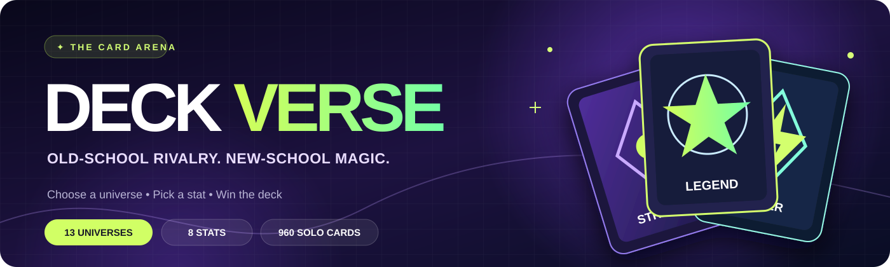
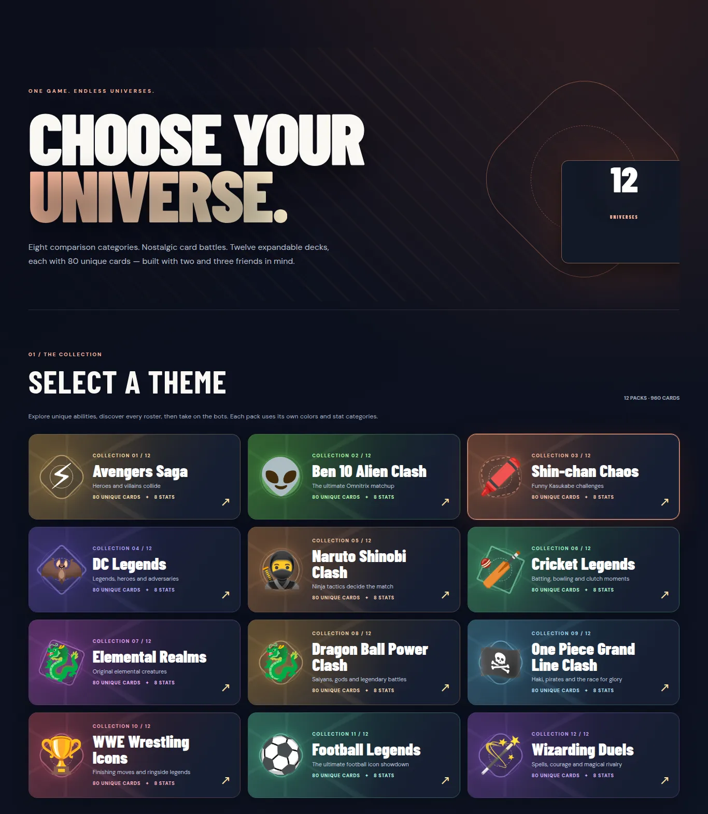
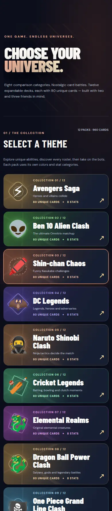
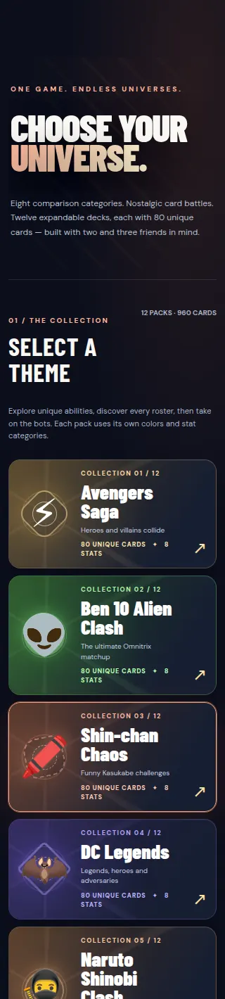
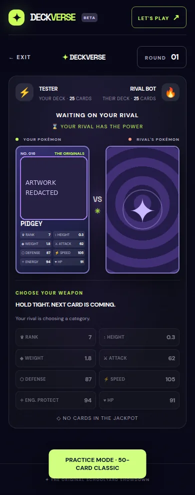

<div align="center">



### Pick your universe. Own the round.

**A nostalgic, mobile-first stat-battle card game—with modern UI, themed decks, bots and private Pokémon rooms.**

[**▶ Play DeckVerse**](https://addictive-themed-card-games.vercel.app/) · [**Explore 12 Solo Packs**](https://addictive-themed-card-games.vercel.app/themes/packs/) · [**View GitHub Actions**](https://github.com/Rishikeshsanin/addictive-themed-card-games/actions)

[](https://github.com/Rishikeshsanin/addictive-themed-card-games/actions/workflows/ci.yml)
[](https://github.com/Rishikeshsanin/addictive-themed-card-games/actions/workflows/theme-packs.yml)


</div>

## ⚡ The quick pitch

Remember those childhood cards where you picked the best stat, won your friend's card and kept battling until someone owned the whole deck?

That's **DeckVerse**: a competitive, collectible-feeling card arena with **13 theme selections**, **eight comparison categories per deck**, interactive reveal sequences, and a clean mobile-first experience. The original Pokémon mode also supports private, server-backed online 1v1 rooms.

> **Current release truth:** Pokémon supports live online **2-player** rooms and solo practice. The **12 expansion packs** support local matches **against bots** at 2, 3 or 4 players. Expansion-pack online rooms are **not yet live**; the database-backed V2 branch remains gated on a separately verified release process.

## 🎮 Pick a deck

| Deck / universe | Collection | Playable mode |
| :-- | :-- | :-- |
| ⚡ **Pokémon Classic** | 200 Pokémon reference entries; curated 50-card online classic | **Online 1v1 + practice** |
| 🦸 Avengers Saga | 80 themed cards | **Solo vs bots** |
| 👽 Ben 10 Alien Clash | 80 themed cards | **Solo vs bots** |
| 🖍️ Shin-chan Chaos | 80 imagined scenario cards (20 × 4) | **Solo vs bots** |
| 🦇 DC Legends | 80 themed cards | **Solo vs bots** |
| 🥷 Naruto Shinobi Clash | 80 themed cards | **Solo vs bots** |
| 🏏 Cricket Legends | 80 themed cards | **Solo vs bots** |
| 🐉 Elemental Realms | 80 **original fantasy creatures** | **Solo vs bots** |
| 🐲 Dragon Ball Power Clash | 80 themed cards | **Solo vs bots** |
| 🏴‍☠️ One Piece Grand Line Clash | 80 themed cards | **Solo vs bots** |
| 🏆 WWE Wrestling Icons | 80 themed cards | **Solo vs bots** |
| ⚽ Football Legends | 80 themed cards | **Solo vs bots** |
| 🪄 Wizarding Duels | 80 themed cards | **Solo vs bots** |

**960 expansion cards** across twelve packs. Scores are **editorial game ratings**, not official power levels, verified sports statistics or canonical rankings. Some ratings are generated from role profiles and need further individual research and balancing.

## 🃏 How a round works

**SHUFFLE → DRAW → PICK A STAT → COMPARE → CLAIM CARDS → REPEAT**

1. Choose a deck and a supported game mode.
2. The cards are shuffled and dealt face-down. **2 players:** 50 cards / 25 each. **3 players:** 60 cards / 20 each. **4 players:** 80 cards / 20 each.
3. The current caller picks one of **eight deck-specific stats**. **Rank: lower wins. Every other category: higher wins.**
4. The winning player takes the contested cards and becomes the next caller.
5. **Tie?** The contested cards go into a jackpot; the decisive winner claims them. Consecutive ties influence who chooses next.
6. Claim the whole deck to win. Matches can be long; an optional quick-match ruleset is not yet implemented.

**No purchases. No pay-to-win.** Bot modes run in the browser; online Pokémon rooms are resolved by the server.

## ✨ What makes it special

| Experience | In the app |
| :-- | :-- |
| **Nostalgic competitive rules** | Rank, jackpots, winner-takes-cards, chooser power and rematches |
| **12 theme-specific solo arenas** | Unique comparisons across anime, superheroes, cartoons, sports and fantasy |
| **Real online Pokémon rooms** | Create/join private 2-player rooms, session recovery and server-controlled turns |
| **Remote-room calling** | Optional LiveKit voice/video in the Pokémon online flow (physical-device QA still pending) |
| **Designed for phones** | Responsive homepage, touch-friendly battle UI and PWA installation |
| **Security-first game state** | Hidden opponent decks, server-side validation and scoped room sessions for the online flow |

## 🖼️ In-game preview — real DeckVerse screenshots

Captured by **real Chromium browser tests running the application**. These are optimized/cropped screenshots from the repository's CI, **not generated mockups**. The Classic battle includes one deliberate artwork redaction.

[**Open the live homepage →**](https://addictive-themed-card-games.vercel.app/) &nbsp;|&nbsp; [**Browse the Theme Lab →**](https://addictive-themed-card-games.vercel.app/themes/packs/) &nbsp;|&nbsp; [**Media provenance →**](docs/media/README.md)

<table>
<tr>
<td width="66%" valign="top"><a href="docs/media/screenshots/theme-lab-desktop-1366.webp"></a></td>
<td width="34%" valign="top"><a href="docs/media/screenshots/theme-lab-mobile-390.webp"></a></td>
</tr>
<tr>
<td align="center"><sub><b>Theme Lab · Desktop</b> — 12 solo theme packs</sub></td>
<td align="center"><sub><b>Theme Lab · Mobile</b> — 390px</sub></td>
</tr>
</table>

<table>
<tr>
<td width="42%" valign="top"><a href="docs/media/screenshots/theme-lab-mobile-320.webp"></a></td>
<td width="58%" valign="top"><a href="docs/media/screenshots/classic-practice-mobile-redacted.webp"></a></td>
</tr>
<tr>
<td align="center"><sub><b>Small mobile</b> — 320px</sub></td>
<td align="center"><sub><b>Pokémon Classic practice</b> — artwork redacted</sub></td>
</tr>
</table>

<sub>Source: [Theme Lab CI #39833945097](https://github.com/Rishikeshsanin/addictive-themed-card-games/actions/runs/39833945097) and [Pokémon browser CI #39937836608](https://github.com/Rishikeshsanin/addictive-themed-card-games/actions/runs/39937836608). These screenshots were taken from local test builds, not live player sessions. Fan-theme names and existing poster designs may have unresolved third-party rights; see [provenance and usage limitations](docs/media/README.md).</sub>

## 🛠️ Built with

`JavaScript / ES Modules` · `HTML5` · `CSS3` · `Node.js` · `Vercel Functions` · `PostgreSQL` · `Supabase Project Hub` · `LiveKit` · `Playwright` · `GitHub Actions`

The site uses vanilla JavaScript instead of a heavyweight frontend framework. Online Pokémon gameplay uses server-side API transactions and an isolated **DeckVerse-only** database schema. Solo theme-pack games are local and do not require database credentials.

## 🚀 Run locally

Requires **Node.js 20+**.

```bash
git clone https://github.com/Rishikeshsanin/addictive-themed-card-games.git
cd addictive-themed-card-games
npm install
npm run dev
```

Then open **http://localhost:4173** and the Theme Lab at **http://localhost:4173/themes/packs/**.

```bash
npm test         # rules and regression tests
npm run test:ui  # browser smoke test (requires a supported local Chrome)
npm run balance  # Pokémon balance checks
npm run simulate # seeded classic Pokémon simulations
```

For real online room endpoints use a suitable local Vercel environment with **DeckVerse-only** server credentials; the static local server does not provide the online API.

## 🧱 Project map

```text
api/                 # Pokémon room API + server-only LiveKit token endpoint
src/                 # Original Pokémon client, game rules and PWA helpers
themes/packs/        # 12 expansion rosters, ratings, local engine + Theme Lab
assets/theme-posters/ # User-supplied art used for seven theme tiles
tests/               # Node tests, UI/browser smoke and regression coverage
.github/workflows/   # GitHub CI + Theme Packs QA
docs/                # Deployment and release safety notes
AGENTS.md            # Mandatory contributor/agent boundaries
SUPABASE_HUB_RULES.md # Shared Project Hub isolation requirements
```

## 🧪 Verified vs. next up

**Verified:** the current `main` branch has passed core GitHub CI after the Wave 2 merge; themed pack QA runs against the expanded catalog; structurally valid 80-card inventories, eight stat categories and 50/60/80-card manifests are tested.

**Still to do:** complete independent factual/character rating review and broad fairness simulations, real physical-device LiveKit tests, and an **approved** DeckVerse-only backup/migration/cutover for online rooms across the expansion packs. More detail lives in [Theme Pack documentation](themes/packs/README.md) and [Deployment notes](docs/DEPLOYMENT.md).

### Safety and scope

The shared Supabase Project Hub is **not a playground**. Every database operation must follow [AGENTS.md](AGENTS.md) and [SUPABASE_HUB_RULES.md](SUPABASE_HUB_RULES.md); never modify unrelated app resources. Do not commit any secret or LiveKit key.

### Fan-project notice

DeckVerse is an independent fan experiment, not affiliated with or endorsed by any depicted entertainment franchise, wrestling promotion or sports body. Third-party names, characters, logos and artwork remain their respective owners' property; this project **does not assert a public redistribution license** for them. For further public use, review the rights to fan posters and source images and obtain permission or substitute original/cleared artwork.

---

<div align="center">

**THE DECK IS YOURS. THE NEXT ROUND ISN'T.**

[Play online](https://addictive-themed-card-games.vercel.app/) · [Solo Theme Lab](https://addictive-themed-card-games.vercel.app/themes/packs/) · [Open an issue](https://github.com/Rishikeshsanin/addictive-themed-card-games/issues)

*Made to bring childhood card-game rivalries back.*

</div>
