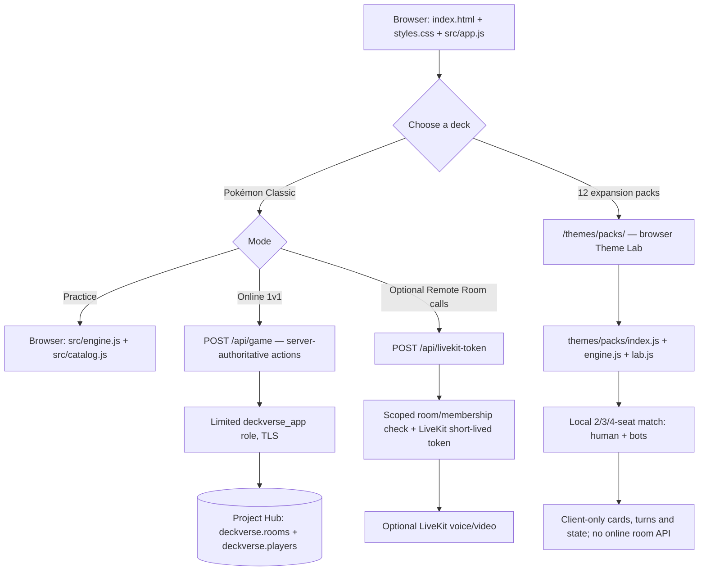

# DeckVerse architecture

**Source baseline:** `main` at `73e933e76d333904bb71793018e8ae8d94a2c69a` (2026-10-23). This map describes the shipped repository, **not** the unmerged V2 eight-theme online release candidates.

The app is **static HTML, CSS, and native JavaScript ES modules**, with two deployed Vercel serverless endpoints for the existing Pokémon online mode. It does not use React, Next.js, a frontend framework, or a public browser-side SQL client.

## Two deliberately different game paths

### Pokémon Classic: practice and existing online **two-player** rooms

- `index.html` renders the original landing/setup/battle screens; `src/app.js` drives UI state and sends room actions to `/api/game`. `src/catalog.js` holds the reference collection and deck manifests; `src/engine.js` handles the classic two-player rules.
- **Solo practice** calls the engine locally. No room credentials or database are required.
- **Online 1v1** posts create, join, lobby, start, select, reveal acknowledgement and leave actions to `api/game.js`. Only the server connects via `DECKVERSE_DATABASE_URL` using the restricted `deckverse_app` role. Room codes identify rooms; opaque tokens authenticate a seat. The server stores hashed tokens, authoritative JSON state, card order and reveal timing in `deckverse.rooms` / `deckverse.players`. **Opponent future cards must stay hidden** in client snapshots.
- `api/livekit-token.js` checks active *remote* room membership and optionally issues short-lived LiveKit room credentials. Calling is **optional** and cannot be a prerequisite to card gameplay. The browser call UI is in `src/livekit-call.js`. Production configuration and actual device connectivity should be verified separately, not inferred from static code.
- `sw.js` and `manifest.webmanifest` provide PWA behavior. The frontend is served as static assets; Vercel supplies serverless API routing in deployment. A plain local static server does **not** magically reproduce Vercel API functions.

### Twelve expansion packs: local browser battles against bots

- `themes/packs/index.html` + `lab.css` + `lab.js` render the dedicated Theme Lab, roster/search and gameplay. `index.js` builds pack manifests from source rosters, bonus rosters and editorial rating data; `engine.js` deals securely shuffled decks and resolves stat comparisons and bot decisions.
- Available selections: **Avengers, Ben 10, Shin-chan, DC, Naruto, Cricket Legends, Elemental Realms, Dragon Ball, One Piece, WWE, Football Legends, Wizarding Duels.** Each has **80 distinct card identities** / **eight comparison axes**. Two seats deal 25 each (50 total), three seats deal 20 each (60), four seats deal 20 each (80).
- These are **local solo matches**: the human controls seat 0, and the other one to three seats are AI bots running in the browser. Do not claim network rooms, remote-human 3/4P, Supabase persistence or LiveKit for any of these packs.
- Rank is the sole **lower-wins** field. Other comparisons use higher-wins. The game scores are **editorial fantasy/stat-card balancing values**, not official power levels or authenticated professional athletic statistics.

## Responsibility and trust boundaries

| Component | Owns | Cannot be assumed to own |
| --- | --- | --- |
| Browser `src/app.js` | Rendering, practice, user input, call controls | Authorization, remote deck order, authoritative online outcomes |
| Vercel `api/game.js` | Existing Pokémon 1v1 sessions, room actions, validation, DB transactions | Unmerged 8/13-theme online system |
| Project Hub `deckverse.*` | Scoped classic room/session persistence | Other apps' data, global project administration |
| `api/livekit-token.js` | Remote-room membership-gated optional call token | Game-state adjudication |
| `themes/packs/*` | 12 expansion card collections and local bot gameplay | Production remote multiplayer or official franchise ratings |

All operations involving the shared database must follow [DeckVerse's safety contract](../AGENTS.md), [Hub rules](../SUPABASE_HUB_RULES.md) and the existing [deployment runbook](DEPLOYMENT.md). No other Hub app should be modified.

## Tests and status boundaries

The **current** `main` scripts run rule tests, theme-pack tests, balance heuristics and Chrome UI smoke (see [local development](LOCAL_DEVELOPMENT.md)). The CI workflow may additionally run production API/browser smoke on `main` pushes; do not run those production-connected test scripts manually without explicit authorization, because they can create real rooms.

There are older **draft**, unmerged eight-theme V2 online branches with `004`–`007` migrations, presence/host-transfer and larger multiplayer server engines. Their existence is not evidence that these features are deployed. **The shipped distinction remains Pokémon online 1v1 + twelve local bot packs.**

### Licensing and provenance

The Pokémon home screen references third-party artwork URLs; existing posters in `assets/theme-posters/` do **not** imply approved redistribution rights. Before commercial/public marketing, review all franchise image/name and athlete publicity rights. Existing rating data must not be presented as canonical facts.
