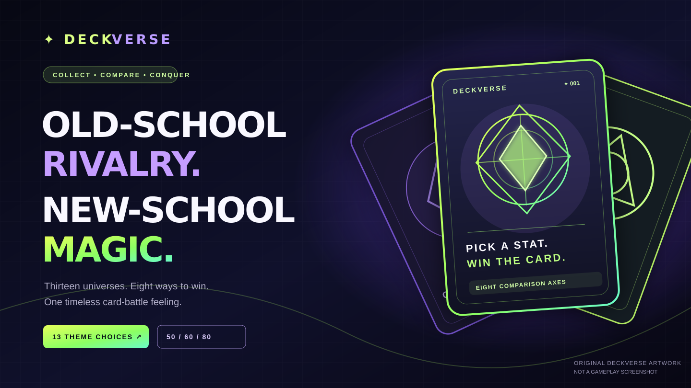
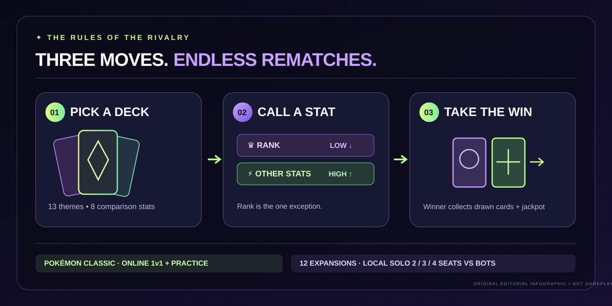

# DeckVerse media gallery — originals and capture provenance

**Artwork version:** 2026-10-23. **Source reviewed:** `main` at `73e933e76d333904bb71793018e8ae8d94a2c69a`. **Palette:** deep black / midnight indigo, electric lime and neon violet. The two assets in this PR are **original SVG illustrations**, **not screenshots of running gameplay**.

The product itself currently has **Pokémon Classic online 1v1 + practice**, **12 expansion packs with local 2/3/4-seat bot battles**, and a PWA. The eight stat categories are theme-specific, with **Rank lower-wins** and other comparisons **higher-wins**. No claim of 13-theme online multiplayer is made.

## Media in this PR

| Preview | File / dimensions | Provenance | Accessible alt-text proposal |
| --- | --- | --- | --- |
|  | [`deckverse-editorial-hero.svg`](deckverse-editorial-hero.svg), **1440 × 810** vector | Newly authored geometric card silhouettes, original lettering and brand treatment. No copied characters or third-party logos. **Editorial illustration only.** | “Original DeckVerse neon brand illustration with abstract collectible cards and the words Old-school rivalry, New-school magic.” |
|  | [`deckverse-how-it-works-original.svg`](deckverse-how-it-works-original.svg), **1440 × 720** vector | Newly authored cards and arrows explaining deck choice, rank/other stat comparison, and winnings. **Instructional illustration only.** | “Original three-step DeckVerse rules infographic: pick a deck, call one of eight stats, and claim cards; Pokémon online 1v1, expansions local bot matches.” |

Both graphics have `title` and `desc` elements for accessibility, intrinsic dimensions, live text, no embedded images and no external network dependencies. They are SVG deliberately: as original author-controlled scalable designs, they avoid bloating Git history with raster assets and remain crisp at 320px / 390px / desktop **when embedded responsively**. Do not confuse graphic responsiveness with verified live app screenshots.

### Rights and attribution

- These specific **abstract geometric illustrations were created for the DeckVerse repository** and do not include external logos, Pokémon sprites, comic/anime characters, athlete faces or stock images.
- This statement applies to **these two SVGs**, not to the app's existing third-party franchise posters, source images, character names or trademarks. The owner must separately review content rights for wider publication and commercial use.
- The text on illustrative cards is conceptual, not a screenshot or a claim that those exact cards/scores exist in the application. No character power/athletic statistics appear.
- Do not edit out the **“NOT A GAMEPLAY SCREENSHOT”** footer when sharing outside the repository.

## Genuine gameplay screenshot workflow (capture not performed here)

The issue asks for authentic battle-state captures at desktop 1366+, mobile 390 and 320. The available execution environment **could not retrieve the deployed Vercel website**, so **no real production screenshots are claimed and no fabricated UI composites were added**.

For a safe reproducible candidate, use the source-controlled **local** Theme Lab's **original Elemental Realms** pack (not Pokémon / unlicensed character illustrations). The optional script [`scripts/capture-repo-gallery.mjs`](../../scripts/capture-repo-gallery.mjs) launches Chromium against a local static server and captures the genuine **`#game` panel** at 1440×900, 390×844 and 320×740 viewports; it checks eight real stat controls and horizontal overflow. It never creates a remote room or requires credentials. Captures are written to a temporary folder for **manual** review; they are not implicitly approved for GitHub.

```bash
npm install
# Terminal 1 (from repo root)
npm run dev
# Terminal 2; set CHROME_PATH to your actual Chromium/Chrome executable
CHROME_PATH=/usr/bin/chromium node scripts/capture-repo-gallery.mjs
```

Alternative static server: `python3 -m http.server 4173 --bind 127.0.0.1`. Browser support comes from `playwright-core`; Chromium/Chrome must already be installed.

**Before publishing any capture:** inspect the actual image, ensure the crop contains no person/room identifier, account/session token or private URL; verify Elemental Realms contains only original permitted art; inspect font legibility at 320/390px; optimize a copy (prefer WebP, at a visually acceptable size), record exact capture date/viewport/command/commit SHA, and validate the render in a GitHub markdown preview. If a capture contains a third-party poster, crop or reject it—do **not** copy it into the repo.

## Honest verification and outstanding gaps

- **Verified in source:** packaged themes and HTML/CSS, screenshot capture selectors from `themes/packs/qa/browser-smoke.mjs`, package scripts, original two-player API, and exact `main` baseline.
- **Authored here:** 2 original SVG images and a reproducible local screenshot helper; no application or database code changed.
- **Not yet verified here:** actual live Vercel screenshots, the optional new capture helper on a running local server, screenshot rights/copyright review, screenshot byte-size optimization, and physical phone display/overflow. Those are explicit coordinator follow-up checks—not false passing claims.
- **Integration:** issue [#52](https://github.com/Rishikeshsanin/addictive-themed-card-games/issues/52) owns these assets; [showcase PR #51](https://github.com/Rishikeshsanin/addictive-themed-card-games/pull/51) owns `README.md`. The coordinator can choose which original artwork to link after reviewing final previews; this agent does **not** edit that README.

> **Production feature accuracy:** Twelve expansion theme solo bot matches do not use the existing Pokémon online 1v1 room API. Existing IP questions remain unresolved for third-party franchise packs.
